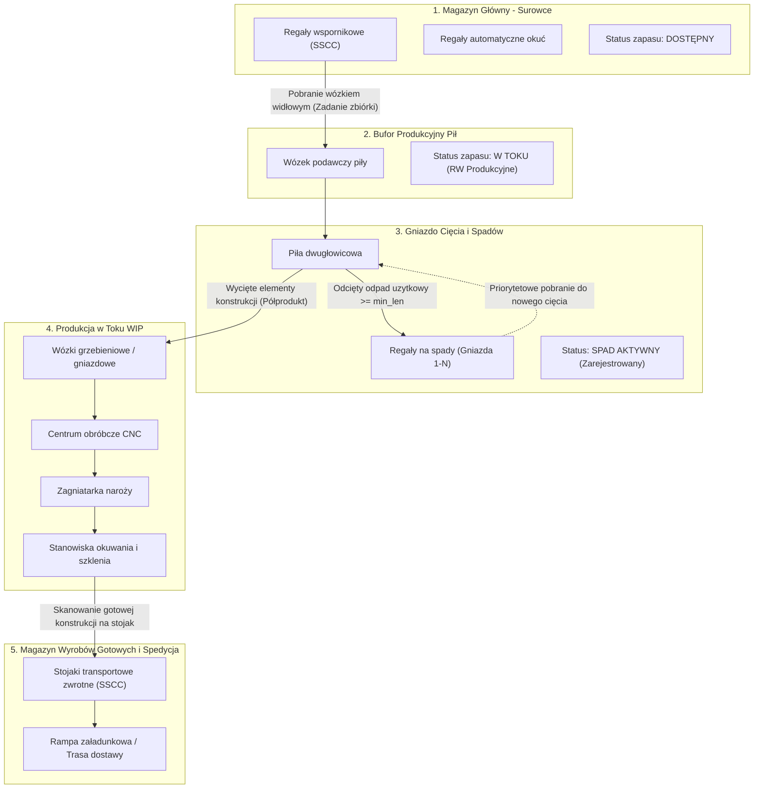
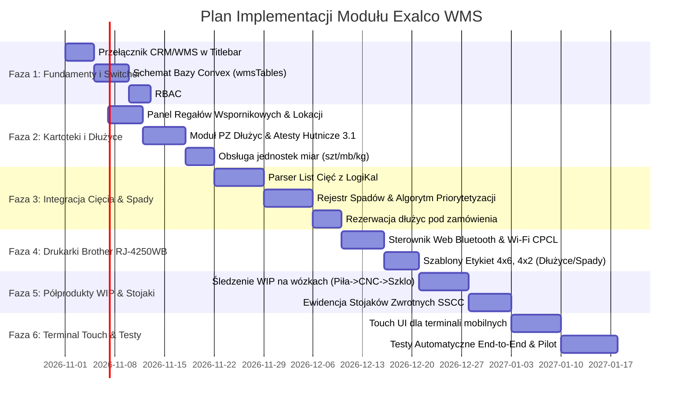

# Dokumentacja Architektury i Plan Implementacji Systemu WMS dla Branży Stolarki Aluminiowej
**Projekt:** Exalco CRM & WMS Platform  
**Wersja:** 1.0 (Dokumentacja Architektoniczna & Plan Realizacji)  
**Data:** Październik 2026  

---

## Spis Treści
1. [Wizja i Architektura Modułowa (Przełącznik CRM ↔ WMS)](#1-wizja-i-architektura-modułowa-przełącznik-crm--wms)
2. [Konfigurowalność i Elastyczność Zakresu Gospodarki Magazynowej](#2-konfigurowalność-i-elastyczność-zakresu-gospodarki-magazynowej)
3. [Specyfika Branży Aluminium i Zarządzanie Asortymentem](#3-specyfika-branży-aluminium-i-zarządzanie-asortymentem)
4. [Kluczowe Procesy Operacyjne WMS](#4-kluczowe-procesy-operacyjne-wms)
5. [Obieg Dokumentów i Architektura Integracji (ERP ↔ LogiKal ↔ WMS/MES)](#5-obieg-dokumentów-i-architektura-integracji-erp--logikal--wmsmes)
6. [Mobilne Drukowanie i Etykietowanie (Brother RJ-4250WB)](#6-mobilne-drukowanie-i-etykietowanie-brother-rj-4250wb)
7. [Analiza Ryzyk Wdrożeniowych i Architektura Odporności (Resilience)](#7-analiza-ryzyk-wdrożeniowych-i-architektura-odporności-resilience)
8. [Architektura Bazy Danych (Model Convex Schema)](#8-architektura-bazy-danych-model-convex-schema)
9. [Kompleksowy Plan Implementacji (Fazy, Zadania, Testy)](#9-kompleksowy-plan-implementacji-fazy-zadania-testy)

---

## 1. Wizja i Architektura Modułowa (Przełącznik CRM ↔ WMS)

### 1.1. Koncepcja Przełącznika Obok Logotypu "Exalco CRM"
System Exalco rozwija się z platformy handlowo-operacyjnej (CRM / Zlecenia / Wyceny) do zintegrowanego ekosystemu fabrycznego. Wymogiem nadrzędnym interfejsu jest **pełne rozdzielenie kontekstu pracy handlowo-biurowej (CRM) od magazynowo-produkcyjnego (WMS)**, przy jednoczesnym zachowaniu wspólnej bazy danych Convex, sesji uwierzytelniania i systemu uprawnień RBAC.

W głównym pasku tytułowym (`fluent-titlebar`) bezpośrednio obok logotypu z literą "E" oraz napisu marki pojawia się nowoczesny **Przełącznik Modułów (Module / Context Switcher)**.

```
+---------------------------------------------------------------------------------------------------------+
| [ E ] Exalco  [ CRM ▾ ]  |  [🔎 Wyszukaj profil, partię, zlecenie, spad... ⌘K]  | (🔔)  [ Jan Kowalski ] |
|                |                                                                                        |
|                +--> 🏢 Exalco CRM  (Handel, Wyceny, Zlecenia, Klienci)                                  |
|                +--> 🏭 Exalco WMS  (Magazyn profili, Spady, WIP, Stojaki)                               |
+---------------------------------------------------------------------------------------------------------+
| [Dłużyce] [Spady] [Pakiety Szybowe] [Okucia] [Kanban] [Listy Cięć] [WIP / Gniazda] [Stojaki SSCC] [PZ/RW] |
+---------------------------------------------------------------------------------------------------------+
```

### 1.2. Warianty Prezentacji Przełącznika w UI
1. **Segmented Switcher (rekomendowany na desktopie i tabletach na wózkach widłowych):**
   - Obok logotypu wyświetlany jest zintegrowany przełącznik pigułkowy:
     `[ 🏢 CRM ] [ 🏭 WMS ]`
   - Kliknięcie powoduje natychmiastowe przejście między `/admin/panel` a `/admin/wms` bez przeładowania całej aplikacji (Next.js App Router).
2. **Dropdown Context Menu:**
   - Obok logo znajduje się selektor `Exalco CRM ▾`, który po kliknięciu rozwija menu z podsumowaniem stanu (np. liczba oczekujących zadań WMS, alerty kwarantanny lakierni).
3. **Pamięć Ostatniego Modułu:**
   - Wybór modułu jest zapamiętywany w profilu użytkownika (`user.preferredModule`) oraz w `localStorage`, dzięki czemu magazynierzy i operatorzy pił po zalogowaniu trafiają od razu do modułu WMS.

### 1.3. Struktura Routingowa i Layouty
- `/admin/*` — Widoki modułu CRM (dotychczasowe: wyceny, zlecenia, klienci, konfigurator).
- `/admin/wms/*` — Dedykowany podmoduł WMS zoptymalizowany pod operacje magazynowe:
  - `/admin/wms` — Dashboard dyspozytorski (stany regałów, alerty spadów, kolejka cięć).
  - `/admin/wms/dluzce` — Ewidencja dłużyc (sztangi 6m/6.5m/7m, atesty, RAL, serie).
  - `/admin/wms/spady` — Dynamiczny rejestr spadów przy piłach z wyszukiwarką wymiarową.
  - `/admin/wms/szyby` — Pakiety szybowe, stojaki A-frame, kompletacja JIT.
  - `/admin/wms/okucia` — Okucia, wersje L/P, integracja z regałami Kardex/półkowymi.
  - `/admin/wms/kanban` — Pojemniki KLT, bufor drobnych akcesoriów, backflushing.
  - `/admin/wms/listy-ciec` — Import list z LogiKal, kolejkowanie, rezerwacja materiałowa.
  - `/admin/wms/wip` — Rejestracja półproduktów na wózkach (Piła → CNC → Zagniatarka → Szklenie).
  - `/admin/wms/stojaki` — Ewidencja stojaków transportowych z kodami SSCC i geolokalizacją.
  - `/admin/wms/dokumenty` — Kartoteka dokumentów PZ, RW, MM, PW, WZ.
  - `/admin/wms/terminal` — Uproszczony, dotykowy widok dla terminali mobilnych i skanerów kodów kreskowych (Touch UI dla rękawic roboczych).

---

## 2. Konfigurowalność i Elastyczność Zakresu Gospodarki Magazynowej

### 2.1. Dynamiczne Granice Zarządzania i Ziarnistość Ewidencji
Administrator systemu posiada panel konfiguracyjny reguł ewidencji materiałowej, w którym decyduje, na jakim poziomie szczegółowości śledzony jest dany indeks materiałowy w zależności od lokalizacji i fazy przetwarzania.

| Kategoria Materiałowa | Typ Ewidencji | Wymagane Atrybuty (Partia / Wymiar) | Typowy Obszar Składowania | Zachowanie Systemowe (WMS) |
|---|---|---|---|---|
| **Dłużyce (Profile aluminiowe)** | Ścisła (Ilościowo-Wartościowa) | Indeks profilu, Długość fabryczna (np. 6500 mm), Kolor (kod RAL / Anoda / Struktura), Numer wytopu/Partii, Atest hutniczy 3.1, Numer nośnika SSCC | Regały wspornikowe wielopoziomowe, Magazyn surowców główny | Pełna identyfikowalność ruchów magazynowych (SSCC). Automatyczna rezerwacja pod zaimportowane listy cięć. Kontrola dopuszczalnych kombinacji lakierniczych. |
| **Pakiety szybowe** | Ścisła z dedykacją | Nr zlecenia nadrzędnego, Nr pozycji/kwatery, Wymiary (szer. x wys. x grubość), Budowa pakietu (np. 4/16/4 U=1.1, VSG), Oznaczenie kierunku montażu | Dedykowane stojaki szybowe (A-frames) w buforze szklenia | Kompletacja pod konkretne zlecenie (Just-in-Time). Blokada wydania na montaż przed dostarczeniem kompletnego zestawu kwater dla konstrukcji. |
| **Okucia (Zasuwnice, klamki, zawiasy)** | Ilościowa | Kod dostawcy (np. Sobinco, Winkhaus, GU), Wersja technologiczna (Lewa/Prawa, nośność), Kategoria bezpieczeństwa (RC2/RC3) | Regały półkowe znakowane kodami kreskowymi, Automatyczne windy regałowe (np. Kardex Remstar) | Kompletacja wózków wydziałowych według BOM zlecenia. Grupowanie pobrań pod kątem optymalizacji trasy magazyniera (Wave picking). |
| **Akcesoria drobne (Wkręty, nity, uszczelki)** | Bezrejestrowa (Kanban) | Indeks znormalizowany (DIN/ISO), Typ opakowania zbiorczego, Min/Max zapas w gnieździe | Pojemniki KLT z kartami RFID/kodami kreskowymi, Bufory przy stanowiskach montażowych | Brak operacji ręcznego rozchodu (RW) w WMS przy każdym zleceniu. Automatyczny rozchód (backflushing) w ERP przy zamknięciu zlecenia. Generowanie sygnału uzupełnienia Kanban po opróżnieniu pojemnika. |
| **Odpad użytkowy (Spady)** | Ścisła (Ilościowa) | Unikalny kod kreskowy spadu (UID), Długość rzeczywista z tolerancją do 1 mm, Identyfikator profilu bazowego, Odcień/partia lakieru | Dedykowane regały na spady przy piłach dwugłowicowych (gniazda pionowe/poziome) | Wymuszona inwentaryzacja ciągła. Bezwzględny priorytet wydania przed pobraniem nowej sztangi przy optymalizacji kolejnych list cięć. |

### 2.2. Logika "Własności" i Stref Magazynowych
Przestrzeń fabryki podzielona jest na sformalizowane strefy o ściśle określonych regułach przejścia stanów magazynowych:



1. **Magazyn Główny (Surowce):** Zarządza pełnymi jednostkami logistycznymi (wiązki, kosze, palety). Materiał ma status `DOSTEPNY` lub `ZAREZERWOWANY`.
2. **Bufor Produkcyjny Pił:** Przejęcie własności następuje w momencie zatwierdzenia zrzutu z regału przez wózkowego. Status zmienia się na `W_TOKU`, a system generuje automatyczny dokument rozchodu wewnętrznego (RW).
3. **Magazyn Odpadów Użytkowych (Strefa Spadów):** Strefa o najwyższej dynamice rotacji. Zintegrowana bezpośrednio z terminalem przy pile. Każde gniazdo regału spadowego (np. `PILA-1-A-03`) jest precyzyjnie zaewidencjonowane w WMS.
4. **Strefa Półproduktów (WIP - Work in Progress):** Własność przenoszona na mobilne wózki gniazdowe/grzebieniowe, śledzone przez skanowanie kodów operacyjnych na maszynach.
5. **Magazyn Stojaków i Wyrobów Gotowych:** Zarządza fizycznymi nośnikami transportowymi (A-frames, stojaki L, palety fasadowe). Ewidencja oparta o numery SSCC i geolokalizację (u klienta / w drodze / zwrot uszkodzony / pusty na placu).

---

## 3. Specyfika Branży Aluminium i Zarządzanie Asortymentem

### 3.1. Wielowymiarowość Indeksów i Konfiguracje Wariantowe
Profil aluminiowy nie może być identyfikowany wyłącznie tradycyjnym kodem SKU. Ten sam profil systemowy (np. ościeżnica ukryta, skrzydło okienne, rygiel fasadowy) charakteryzuje się wektorem cech:
$$\text{Indeks WMS} = \langle \text{Seria Systemowa}, \text{Nr Profilu}, \text{Wykończenie}, \text{Długość}, \text{Przekładka Termiczna}, \text{Wytop} \rangle$$

- **Wykończenie powierzchni:**
  - Surowe (mill finish) – przeznaczone do lakierowania po prefabrykacji lub w kooperacji.
  - Lakier proszkowy standardowy (np. RAL 7016 Antracyt Mat, RAL 9016 Biały, RAL 9005 Czarny Głęboki).
  - Kolory niestandardowe / specjalne (kolory z palety IGP, Tiger, struktury drobne, metaliki, dwukolor/bicolor).
  - Anodowanie (anoda naturalna C-0, brąz, szampan, czerń, grubość powłoki 15–20 $\mu\text{m}$).
- **Jednostki miary wielokrotnej:**
  System musi w sposób bezszwowy i automatyczny przeliczać jednostki:
  - **Sztuki:** podstawowa jednostka manipulacyjna magazyniera.
  - **Metry bieżące (mb):** jednostka rozliczeniowa kalkulatora, list cięć i spadów.
  - **Kilogramy (kg):** jednostka rozliczeniowa dostaw hutniczych, lakierni oraz kalkulacji logistycznych (waga nominalna profilu wg matrycy $\text{kg/mb}$).

### 3.2. Identyfikacja i Traceability (Atesty Hutnicze 3.1 i Certyfikacja CE)
W projektach fasadowych, świetlikach oraz stolarki obiektowej (dla zamówień publicznych i deweloperskich) istnieje restrykcyjny wymóg udokumentowania pochodzenia każdej użytej partii stopu aluminium (EN 10204 3.1).
- Każda partia dłużyc przyjmowana na stan musi mieć powiązany plik PDF atestu hutniczego (skład chemiczny stopu np. EN AW-6060 T66, wytrzymałość $R_m$, granica plastyczności $R_{p0.2}$).
- Przy wycięciu elementu ze zlecenia, WMS dziedziczy numer wytopu i certyfikat, przypisując go do identyfikatora półproduktu.
- **Kwarantanna Jakościowa Lakierni:** System wprowadza cyfrową blokadę (`QUALITY_HOLD`). Profile powracające z lakierni zewnętrznej lub wewnętrznej nie mogą być pobrane do cięcia, dopóki kontroler jakości nie zatwierdzi raportu z pomiaru grubości powłoki (min. 60–80 $\mu\text{m}$) oraz testu przyczepności (siatka nacięć).

### 3.3. Gospodarka Odpadami Użytkowymi (Spady) – Algorytm Minimalizacji Strat
Resztki profili po odcięciu stanowią kluczowy czynnik rentowności przetwórcy aluminium. System WMS implementuje mechanizm zautomatyzowanego zarządzania spadem:
1. **Reguła Minimalnej Długości Użytecznej ($L_{\min}$):**
   - Parametr konfigurowalny per seria profilu (np. dla profili ościeżnic $L_{\min} = 800\text{ mm}$, dla profili adaptacyjnych $L_{\min} = 500\text{ mm}$, poniżej tej wartości profil traktowany jest jako złom aluminiowy do wanny ze ścinkami).
2. **Natychmiastowy Cykl Rejestracji:**
   - Bezpośrednio po odcięciu ostatniego elementu ze sztangi na ekranie piły pojawia się monit: *"Pozostało: 1342 mm. Zarejestrować spad?"*.
   - Jedno dotknięcie ekranu lub skan kodem powoduje wydruk etykiety na drukarce Brother RJ-4250WB.
   - WMS wskazuje wolne gniazdo regałowe przy pile (np. `SPAD-P1-R2-08`).
3. **Pętla Informacji Zwrotnej do Optymalizatora (LogiKal):**
   - Zarejestrowany spad natychmiast pojawia się w wirtualnym magazynie dostępnym dla silnika optymalizacji cięcia.
   - Podczas generowania kolejnego zlecenia produkcyjnego LogiKal w pierwszej kolejności dopasowuje odcinane elementy do istniejących spadów.
   - Na terminalu operatora piły WMS wyświetla zadanie: **"KROK 1: POBIERZ SPAD #SPD-98124 z gniazda SPAD-P1-R2-08 (1342 mm)"** z podświetleniem graficznym. Dopiero po zużyciu wskazanego spadu system pozwala na pobranie nowej sztangi 6500 mm.

---

## 4. Kluczowe Procesy Operacyjne WMS

### 4.1. Przyjęcie Towaru (PZ) i Dwuetapowa Kontrola Jakości
Dostawy profili od systemodawców (np. Reynaers, Aluprof, Aliplast, Schüco) są przyjmowane w procedurze dwuetapowej:
1. **Etap 1: Kontrola Ilościowa i Stanu Opakowań Zbiorczych:**
   - Weryfikacja liczby koszy/wiązek z listem przewozowym (CMR).
   - Wprowadzenie dokumentu PZ Awizo w WMS.
2. **Etap 2: Rozładunek, Identyfikacja i Kontrola Powłoki:**
   - Magazynier skanuje etykietę dostawcy (jeśli posiada kod GS1-128) lub drukuje etykietę magazynową Exalco WMS 4x6".
   - Inspekcja wizualna: sprawdzenie zarysowań, odprysków i wgnieceń.
   - **Procedura Zarysowań:** W przypadku uszkodzenia mechanicznego profilu magazynier oznacza na terminalu pozycję wady (np. "zarysowanie na 3200 mm"). WMS automatycznie kwalifikuje część profilu jako wadliwą, umożliwiając rozcięcie na pełnowartościowe odcinki krótsze lub wszczęcie procedury reklamacyjnej (protokół szkody z fotodokumentacją dołączaną ze skanera/telefonu).

### 4.2. Składowanie i Optymalizacja Rozmieszczenia (ABC / XYZ)
Profile aluminiowe są składowane na wielopoziomowych regałach wspornikowych. System optymalizuje alokację według wytycznych:
- **Kryterium Wagi i Bezpieczeństwa:** Najcięższe profile fasadowe i wielkogabarytowe słupy nośne lokowane są na najniższych poziomach wsporników (poziom 0 i 1).
- **Kryterium Rotacji (Klasa A):** Standardowe kolory systemowe (RAL 7016 Antracyt, RAL 9005 Czarny Mat) umieszczane są w alejach bezpośrednio przylegających do bufora podawczego pił, minimalizując drogę pokonywaną przez wózki dłużycowe (boczne).
- **Profile Specjalne i Nierotujące (Klasa C):** Wysokie poziomy regałów wspornikowych lub strefa buforowa magazynu wysokiego składowania.

### 4.3. Wydanie na Produkcję (RW / PW)
Wydanie surowca nie odbywa się na zasadzie pobrań pojedynczych referencji, lecz w powiązaniu z **zadaniami produkcyjnymi**:
- WMS agreguje zapotrzebowanie z zaimportowanej listy cięć.
- Wózkowy otrzymuje na terminalu trasę zbiórki (Pick list) dla pełnych koszy dłużyc.
- Zeskanowanie lokalizacji wspornika i kodu wiązki potwierdza pobranie i przenosi zapas z lokalizacji `MAG-GLOWNY` do `BUFOR-PILA-1`.
- Równolegle generowane jest zadanie kompletacji okuć i akcesoriów z regałów Kardex do oznaczonego wózka wydziałowego zlecenia.

### 4.4. Rejestracja Półproduktów (WIP) w Pętli Gniazdowej
Po wycięciu elementu na pile dwugłowicowej materiał przestaje być surowcem i staje się **półproduktem (WIP)**:
1. Profil otrzymuje etykietę ze skróconym kodem DataMatrix.
2. Element trafia na dedykowany wózek gniazdowy (np. `WOZEK-GN-04`).
3. Kolejne operacje technologiczne są rejestrowane przez zbliżenie skanera:
   - **Centrum Obróbkowe CNC:** Skaner na maszynie wczytuje kod z etykiety, co powoduje automatyczne wywołanie odpowiedniego programu obróbczego (frezowania pod zamki, klamki, odwadniacze). Zakończenie cyklu maszynowego zmienia status na `CNC_COMPLETED`.
   - **Zagniatarka Naroży:** Połączenie profili ramy/skrzydła za pomocą narożników zagniatanych i kleju dwuskładnikowego. Rejestracja utworzenia konstrukcji ramowej.
   - **Stanowisko Uszczelniania i Szklenia:** Zeskanowanie ramy oraz zeskanowanie kodu przydzielonego pakietu szybowego z magazynu szyb. System waliduje poprawność sparowania szyby z ramą!

### 4.5. Wyrób Gotowy, Stojaki Zwrotne i Spedycja (SSCC)
Gotowe konstrukcje (okna, drzwi aluminiowe, fasady segmentowe) wymagają bezpiecznego transportu:
- Każdy stojak transportowy (A-frame o konstrukcji stalowej) posiada trwały metalowy znacznik z kodem kreskowym / QR oraz unikalnym numerem **SSCC (Serial Shipping Container Code)**.
- Pakowacz skanuje kod stojaka, a następnie skanuje kody gotowych okien wstawianych na stojak.
- WMS weryfikuje kompletność zlecenia i zabezpieczenie przed przekroczeniem dopuszczalnej ładowności stojaka (waga sumaryczna).
- Wydanie zewnętrzne (WZ): Przy załadunku na auto kierowca skanuje stojaki. WMS automatycznie generuje dokument WZ i przypisuje stojak jako opakowanie zwrotne powiązane z kartoteką klienta, monitorując termin zwrotu (eliminacja zagubionych stojaków o wartości kilku tysięcy złotych każdy).

---

## 5. Obieg Dokumentów i Architektura Integracji (ERP ↔ LogiKal ↔ WMS/MES)

Płynna wymiana danych w ułamkach sekund pomiędzy systemem handlowym, silnikiem optymalizacji technicznej i systemem magazynowym:

```mermaid
sequenceDiagram
    autonumber
    actor Biuro as Biuro Handlowe (ERP / CRM)
    participant Opt as Orgadata LogiKal
    participant WMS as Exalco WMS (Convex)
    actor Magazynier as Operator Wózka / Piły
    actor Maszyna as Maszyny CNC / Gniazda

    Biuro->>Opt: Eksport zlecenia handlowego (wymiary, konfiguracja profili)
    Note over Opt: Kalkulacja technologiczna, optymalizacja cięcia profili
    Opt->>WMS: API / Webhook: Przesłanie Listy Cięć (BOM technologiczny)
    WMS->>WMS: Rezerwacja dłużyc na wspornikach + rezerwacja spadów
    WMS-->>Biuro: Potwierdzenie dostępności surowca (Status: ZAPLANOWANE)
    
    WMS->>Magazynier: Zadanie zbiórki na terminal wózka (Pobranie dłużyc)
    Magazynier->>WMS: Skan pobrania z regału do bufora piły
    WMS->>Biuro: Generowanie dokumentu RW (Rozchód surowca)
    
    Magazynier->>WMS: Potwierdzenie cięcia na pile dwugłowicowej
    WMS->>Magazynier: Auto-druk etykiety półproduktu + etykiety spadu (Brother)
    WMS->>Opt: Rejestracja nowego spadu (długość, ID, gniazdo) do puli optymalizatora
    
    Magazynier->>Maszyna: Odłożenie na wózek WIP -> Przejście do CNC
    Maszyna->>WMS: Skan kodu -> Zmiana lokalizacji (MM: Cięcie -> CNC)
    
    Maszyna->>WMS: Zeskanowanie wyrobu gotowego na stojak transportowy SSCC
    WMS->>Biuro: Dokument PW (Przychód wyrobu) + Generowanie WZ
```

### Specyfikacja Interfejsów Integracyjnych
1. **Interfejs LogiKal → WMS (Import Listy Cięć):**
   - Format: JSON przez dedykowany endpoint `/api/wms/import-cutlist` lub parser plików XML/CSV generowanych przez LogiKal.
   - Zawartość rekordu: identyfikator partii cięcia, numer zlecenia, indeks profilu, kolor, długość odcinana, kąt cięcia lewy ($45^\circ/90^\circ$), kąt cięcia prawy, identyfikator elementu w konstrukcji, numer przypisanego spadu (jeśli użyty).
2. **Interfejs WMS → ERP (Księgowość Magazynowa):**
   - Emisja standardowych dokumentów magazynowych:
     - **PZ (Przychód Zewnętrzny):** przyjęcie dostawy od huty/systemodawcy.
     - **RW (Rozchód Wewnętrzny):** zrzut dłużycy do bufora cięcia.
     - **MM (Przesunięcie Międzymagazynowe):** przesunięcia między halami i gniazdami.
     - **PW (Przychód Wewnętrzny):** przyjęcie gotowej stolarki na magazyn wyrobów.
     - **WZ (Wydanie Zewnętrzne):** wysyłka stojaków do klienta/na budowę.
3. **Powiadomienia w Czasie Rzeczywistym (Convex Subscriptions):**
   - Całość modułu oparta na reaktywnych subskrypcjach Convex — zmiana statusu zlecenia w CRM jest widoczna na terminalu magazyniera w ciągu <50 ms bez potrzeby odświeżania strony.

---

## 6. Mobilne Drukowanie i Etykietowanie (Brother RJ-4250WB)

### 6.1. Specyfikacja Drukarek Mobilnych
Drukarki **Brother RJ-4250WB** to urządzenia klasy przemysłowej (szerokość druku 4 cale / 104 mm, termiczny druk wysokiej rozdzielczości 203 dpi, odporność na upadki z wysokości 2.1 m, norma szczelności IP54, łączność Dual Wi-Fi 2.4/5GHz oraz Bluetooth 4.2 MFi).

### 6.2. Architektura Komunikacji z Drukarką
Aby zapewnić niezawodność w warunkach zakłóceń elektromagnetycznych hali produkcyjnej, system wspiera **dwa równoległe kanały komunikacji**:
1. **Tryb Bezpośredni Bluetooth (Terminal Handheld / Tablet → Drukarka na Pasku):**
   - Wykorzystanie interfejsu Web Bluetooth API w aplikacji mobilnej PWA lub natywnego konektora.
   - Operator wykonujący cięcie nie zależy od zasięgu sieci Wi-Fi — po wciśnięciu przycisku na terminalu polecenie druku trafia bezpośrednio przez Bluetooth, gwarantując wydruk w ułamku sekundy.
2. **Tryb Sieciowy Wi-Fi (Centralny Serwer Wydruków / Drukarki Stacjonarne):**
   - Drukarki przypisane do stanowisk stałych (np. rampa rozładunkowa PZ, pakownia wysyłek) nasłuchują na porcie 9100 (Raw Socket) lub komunikują się przez lekki mikroserwis print-servera Exalco.

```
+-------------------------------------------------------------------------------+
|                        ARCHITEKTURA DRUKU MOBILNEGO                           |
|                                                                               |
|  [ Terminal Mobilny PWA ]                                                     |
|         |                                                                     |
|         +---(Bluetooth LE)--------> [ Brother RJ-4250WB na pasku operatora ]   |
|         |                           (Wydruk natychmiastowy bez Wi-Fi)         |
|         |                                                                     |
|         +---(HTTPS/WebSocket)-----> [ Convex Backend ]                        |
|                                            |                                  |
|                                     (Lokalny Broker)                          |
|                                            v                                  |
|                                     [ Brother RJ-4250WB Rampa PZ (Wi-Fi) ]    |
+-------------------------------------------------------------------------------+
```

### 6.3. Precyzyjne Szablony Etykiet Przemysłowych

#### a) Etykieta Magazynowa Dłużycy (Format 4x6" / 102 x 152 mm)
- **Zastosowanie:** Przyjęcie PZ surowca od dostawcy, naklejana na czole paczki lub na sztandze.
- **Układ danych:**
  - Nagłówek: Logo Exalco + Kod kreskowy SSCC jednostki logistycznej.
  - Sekcja Główna: Wytłuszczony indeks profilu (np. `ALUPROF MB-86N SI / OŚCIEŻNICA`).
  - Długość nominalna: `6500 mm` (wielki font 36pt).
  - Kolorystyka: `RAL 7016 MAT` + informacja o powłoce (np. `Kwalifikacja Qualicoat`).
  - Identyfikowalność: `Partia: P-2026-10-881`, `Atest: CE-EN14351-1-A1`, `Huta: Kety`.
  - Kod kreskowy: GS1-128 zawierający AI (01 - GTIN, 10 - Partia, 3102 - Waga kg, 30 - Ilość sztuk).

#### b) Etykieta Półproduktu Wyciętego (Format 4x2" lub 4x4" / 102 x 50 mm)
- **Zastosowanie:** Druk bezpośrednio przy pile dwugłowicowej, naklejana na **wewnętrznej stronie profilu** (pod późniejszą listwą przyszybową / uszczelką, dzięki czemu nie wymaga odklejania po montażu).
- **Układ danych:**
  - Lewa strona: Nr Zlecenia: `ZL/2026/0412` | Klient: `VentureBox Tower`.
  - Pozycja w konstrukcji: `POZ. 04 / RAMA LEWA / SKRZYDŁO AKTYWNE`.
  - Wymiar cięcia: `1450.5 mm` (z dokładnością do dziesiętnych milimetra).
  - Graficzne ikony kątów cięcia: `∡ L: 45° | ∡ P: 90°` (wraz ze strzałką kierunku bazowania profilu na pilarce).
  - Prawa strona: Kod DataMatrix 2D – zeskanowanie na centrum CNC automatycznie ładuje program obróbki otworów pod zawiasy.

#### c) Etykieta Spadu / Odpadu Użytkowego (Format 4x2" / 102 x 50 mm)
- **Zastosowanie:** Naklejana na odciętej resztce profilu, która spełnia kryterium długości użytecznej.
- **Układ danych:**
  - **Wielki font ostrzegawczy:** `SPAD: 1145 mm` (czytelny z odległości 3 metrów na regale).
  - Kod QR: Bezpośredni deep-link do identyfikatora spadu w WMS (`wms://remnant/SP-99214`).
  - Informacje bazowe: Profil `MB-86N`, Kolor `RAL 9005 MAT`, Data cięcia.
  - Wskazane gniazdo składowania: `REGAŁ P1 / GNIAZDO B-12`.

#### d) Etykieta Logistyczna Stojaka Transportowego (Format 4x6" / 102 x 152 mm)
- **Zastosowanie:** Znakowanie stojaków wysyłkowych z gotową stolarką.
- **Układ danych:**
  - Zgodność ze standardem GS1 Logistics Label.
  - Numer SSCC stojaka w formacie cyfrowym oraz kod kreskowy GS1-128 na dole etykiety.
  - Dane inwestycji / obiektu budowlanego oraz numer kontraktu.
  - Wykaz zawartości w formie dynamicznego kodu QR (np. 12 okien rozwierno-uchylnych, 2 drzwi przesuwnych HS).
  - Całkowita masa brutto stojaka (np. `740 kg`) + ostrzeżenie o środku ciężkości.
  - Trasa dostawy i identyfikator kierowcy/pojazdu spedycyjnego.

---

## 7. Analiza Ryzyk Wdrożeniowych i Architektura Odporności (Resilience)

### 7.1. Ryzyko 1: "Efekt Klatki Faradaya" na Hali Produkcyjnej
- **Charakterystyka problemu:** Konstrukcja hali (płyty warstwowe ze stalowym rdzeniem), wysokie regały wspornikowe z setkami ton profili aluminiowych oraz siatki ochronne maszyn CNC tworzą strefy całkowitego cienia radiowego. Tradycyjna aplikacja webowa traci sesję, co skutkuje przerwaniem procesu rejestracji i frustracją załogi.
- **Rozwiązanie Architektoniczne w Exalco WMS:**
  1. **Architektura Offline-First (PWA + Service Worker):** Widok terminalowy WMS działa w trybie Progressive Web App. Kluczowe słowniki i kolejki zleceń są synchronizowane do lokalnej bazy przeglądarki (IndexedDB).
  2. **Optymistyczne Kolejkowanie Mutacji (Outbox Pattern):** Zeskanowanie kodu lub zatwierdzenie cięcia zapisuje zdarzenie w lokalnej kolejce offline. Interfejs natychmiast przechodzi do kolejnego kroku, nie blokując operatora. Gdy sygnał Wi-Fi powróci, kolejka automatycznie synchronizuje się z backendem Convex z gwarancją idempotencji (`idempotencyKey`).
  3. **Lokalny Druk Bluetooth:** Drukowanie na Brother RJ-4250WB odbywa się bezpośrednio z terminala przez Bluetooth, całkowicie omijając infrastrukturę sieciową Wi-Fi.

### 7.2. Ryzyko 2: "Dyscyplina Inwentaryzacyjna Spadów" i Omijanie Procedur
- **Charakterystyka problemu:** Operator pod presją czasu może pominąć oklejenie spadu i odłożyć go w przypadkowe miejsce. W kolejnym zleceniu optymalizator zaplanuje cięcie ze spadu, którego fizycznie nie ma na wskazanym gnieździe, paraliżując pracę piły i zmuszając do nieautoryzowanego pobrania nowej, drogiej sztangi 6.5 m.
- **Rozwiązanie Systemowe w Exalco WMS:**
  1. **Zasada "Wymuszonego Potwierdzenia Dwukrokowego":** Operator nie może zamknąć zadania cięcia na ekranie terminala bez:
     - Wygenerowania i potwierdzenia wydruku etykiety spadu.
     - Zeskanowania kodu kreskowego gniazda regału spadowego (weryfikacja, że spad fizycznie trafił do właściwej przegrody).
  2. **Automatyczny Bufor Rezerwowy Optymalizatora:** Jeśli podczas pobierania operator zgłosi "Brak spadu w gnieździe" (przycisk awaryjny), WMS natychmiast oznacza dany spad statusem `LOST_INVENT_PENDING`, przelicza alternatywną ścieżkę i generuje dyspozycję zrzutu nowej sztangi, jednocześnie kierując powiadomienie do brygadzisty o konieczności inwentaryzacji gniazda.
  3. **Wymuszona Inwentaryzacja Ciągła (Cycle Counting):** System losowo lub przy spadku obłożenia zleceniami wymusza na operatorze szybkie przeliczenie 3 wybranych gniazd spadowych (zajmuje to <60 sekund).

### 7.3. Ryzyko 3: Ergonomia Interfejsu w Warunkach Przemysłowych
- **Charakterystyka problemu:** Standardowe interfejsy CRM z małymi przyciskami i gęstymi tabelami są całkowicie bezużyteczne dla pracownika w rękawicach ochronnych, operującego terminalem z ekranem 5 cali.
- **Rozwiązanie w Exalco WMS Terminal UI:**
  - Minimalny rozmiar elementów dotykowych: minimum $64 \times 64\text{ px}$.
  - Wysoki kontrast (tryb Industrial Dark / High-Contrast Yellow/Black).
  - Informacje zwrotne w 3 kanałach: wizualny (duży zielony/czerwony baner), wibracja terminala (Haptic Feedback) oraz donośny sygnał dźwiękowy (Audio BEEP sukces/błąd).
  - Obsługa sprzętowych wyzwalaczy skanera (hardware trigger Zebra / Honeywell / skanery pierścieniowe na palec).

---

## 8. Architektura Bazy Danych (Model Convex Schema)

Poniższy model danych rozszerza dotychczasowy plik `convex/schema.ts` o dedykowany, spójny podsystem WMS powiązany z istniejącymi tabelami zasileń (`orders`, `materials`, `users`):

```typescript
// convex/schema.ts (Rozszerzenie o moduł WMS)
import { defineTable } from "convex/server";
import { v } from "convex/values";

export const wmsTables = {
  // 1. Kartoteka Lokalizacji Magazynowych i Regałów
  wms_locations: defineTable({
    code: v.string(), // np. "REG-WSP-A-01-02", "PILA-1-BUFOR", "SPAD-P1-04"
    name: v.string(),
    zone: v.union(
      v.literal("MAGAZYN_GLOWNY"),     // Regały wspornikowe
      v.literal("BUFOR_PRODUKCJA"),    // Przy maszynach
      v.literal("STREFA_SPADOW"),      // Regały na resztki
      v.literal("REGAŁ_OKUCIA"),       // Regały półkowe / Kardex
      v.literal("BUFOR_SZYB"),         // Stojaki A-frame na szyby
      v.literal("SPEDYCJA_WYROBY"),    // Gotowe stojaki przed załadunkiem
      v.literal("KWARANTANNA")         // Zablokowane jakościowo
    ),
    type: v.union(
      v.literal("CANTILEVER"),         // Regał wspornikowy dłużyc
      v.literal("SHELF"),              // Regał półkowy
      v.literal("VERTICAL_SLOT"),      // Przegroda pionowa na spady
      v.literal("FLOOR_BUFFER"),       // Pole odkładcze
      v.literal("RACK_SLOT")           // Miejsce na stojak
    ),
    maxWeightKg: v.optional(v.number()),
    maxLengthMm: v.optional(v.number()),
    isActive: v.boolean(),
  })
    .index("by_code", ["code"])
    .index("by_zone", ["zone"]),

  // 2. Ewidencja Fizycznych Partii i Sztang (Dłużyce)
  wms_stock_items: defineTable({
    materialId: v.optional(v.id("materials")), // powiązanie ze słownikiem cennika
    profileCode: v.string(),                   // np. "MB-86N-RAMA"
    systemSeries: v.string(),                 // np. "Aluprof MB-86N"
    colorCode: v.string(),                    // np. "RAL7016_MAT"
    colorDescription: v.string(),
    surfaceType: v.union(v.literal("MILL"), v.literal("RAL"), v.literal("ANODA"), v.literal("BICOLOR")),
    lengthMm: v.number(),                     // np. 6500
    quantityPieces: v.number(),               // liczba sztang w wiązce
    totalMeters: v.number(),                  // łączna liczba mb
    weightKg: v.optional(v.number()),
    locationId: v.id("wms_locations"),
    ssccBarcode: v.optional(v.string()),      // numer nośnika / wiązki
    heatBatchNumber: v.optional(v.string()),  // numer wytopu / partii
    millCertificateUrl: v.optional(v.string()), // Atest 3.1 PDF
    status: v.union(
      v.literal("AVAILABLE"),                 // Dostępny
      v.literal("RESERVED"),                  // Zarezerwowany pod listę cięć
      v.literal("IN_CUTTING_BUFFER"),         // W trakcie cięcia
      v.literal("QUALITY_HOLD")               // Kwarantanna / wada powłoki
    ),
    createdAt: v.number(),
    updatedAt: v.number(),
  })
    .index("by_profile_color", ["profileCode", "colorCode"])
    .index("by_location", ["locationId"])
    .index("by_sscc", ["ssccBarcode"])
    .index("by_status", ["status"]),

  // 3. Ewidencja Spadów / Odpadów Użytkowych (Priorytet Optymalizacji)
  wms_remnants: defineTable({
    remnantBarcode: v.string(),               // Unikalny UID spadu, np. "SPD-881924"
    profileCode: v.string(),                  // Indeks profilu
    systemSeries: v.string(),
    colorCode: v.string(),
    lengthMm: v.number(),                     // Dokładna długość resztki w mm (np. 1245)
    locationId: v.id("wms_locations"),        // Gniazdo regału spadowego
    originStockItemId: v.optional(v.id("wms_stock_items")), // Sztanga źródłowa
    createdFromOrderId: v.optional(v.id("orders")),        // Zlecenie, w którym powstał
    reservedForOrderId: v.optional(v.id("orders")),        // Zlecenie, pod które został zarezerwowany
    reservedForCutListId: v.optional(v.string()),
    status: v.union(
      v.literal("AVAILABLE"),                 // Gotowy do użycia przez LogiKal
      v.literal("RESERVED"),                  // Przypisany do kolejnego cięcia
      v.literal("CONSUMED"),                  // Zużyty (archiwum)
      v.literal("SCRAPPED"),                  // Przekazany na złom
      v.literal("LOST")                       // Brak podczas próby pobrania
    ),
    createdAt: v.number(),
    consumedAt: v.optional(v.number()),
  })
    .index("by_barcode", ["remnantBarcode"])
    .index("by_profile_len", ["profileCode", "lengthMm"])
    .index("by_status", ["status"])
    .index("by_location", ["locationId"]),

  // 4. Zaimportowane Listy Cięć (Integracja LogiKal)
  wms_cut_lists: defineTable({
    orderId: v.id("orders"),                  // Powiązanie ze zleceniem Exalco CRM
    logikalBatchId: v.string(),               // Identyfikator optymalizacji LogiKal
    status: v.union(
      v.literal("IMPORTED"),                  // Zaimportowana, oczekuje
      v.literal("RESERVED"),                  // Materiał zarezerwowany
      v.literal("IN_PROGRESS"),               // Trwa cięcie na hali
      v.literal("COMPLETED"),                 // Pocięte, półprodukty wydane
      v.literal("CANCELLED")
    ),
    totalCutsCount: v.number(),
    completedCutsCount: v.number(),
    assignedSawId: v.optional(v.string()),    // np. "PILA_ELUMATEC_01"
    items: v.array(
      v.object({
        cutItemId: v.string(),
        elementDescription: v.string(),       // np. "Rama lewa"
        profileCode: v.string(),
        colorCode: v.string(),
        requiredLengthMm: v.number(),
        angleLeft: v.number(),                // np. 45
        angleRight: v.number(),               // np. 90
        sourceType: v.union(v.literal("NEW_STOCK"), v.literal("REMNANT")),
        sourceRemnantId: v.optional(v.id("wms_remnants")),
        sourceStockItemId: v.optional(v.id("wms_stock_items")),
        isCut: v.boolean(),
        cutAt: v.optional(v.number()),
        operatorId: v.optional(v.id("users")),
        wipBarcode: v.optional(v.string()),   // Wygenerowany kod półproduktu
      })
    ),
    createdAt: v.number(),
    updatedAt: v.number(),
  })
    .index("by_order", ["orderId"])
    .index("by_status", ["status"]),

  // 5. Półprodukty w Toku (WIP) i Wózki Gniazdowe
  wms_wip_items: defineTable({
    wipBarcode: v.string(),                   // Kod z etykiety półproduktu 4x2"
    orderId: v.id("orders"),
    cutListId: v.id("wms_cut_lists"),
    elementDescription: v.string(),
    profileCode: v.string(),
    colorCode: v.string(),
    lengthMm: v.number(),
    currentCartCode: v.optional(v.string()),  // Wózek gniazdowy, np. "WZ-04"
    currentStage: v.union(
      v.literal("CUT"),                       // Wycięty na pile
      v.literal("CNC"),                       // Obróbka otworów CNC
      v.literal("CRIMPING"),                  // Zagniatanie naroży
      v.literal("SEALING_GLAZING"),           // Uszczelnianie i szklenie
      v.literal("QUALITY_PASSED"),            // Kontrola jakości gotowego okna
      v.literal("ON_SHIPPING_RACK")           // Załadowane na stojak wysyłkowy
    ),
    cncProgramName: v.optional(v.string()),
    history: v.array(
      v.object({
        stage: v.string(),
        timestamp: v.number(),
        operatorId: v.id("users"),
      })
    ),
  })
    .index("by_wipBarcode", ["wipBarcode"])
    .index("by_order", ["orderId"])
    .index("by_currentStage", ["currentStage"]),

  // 6. Stojaki Transportowe Zwrotne i Spedycja
  wms_transport_racks: defineTable({
    rackCode: v.string(),                     // np. "ST-A-104"
    ssccBarcode: v.string(),                  // Unikalny kod SSCC
    type: v.union(v.literal("A_FRAME"), v.literal("L_STAND"), v.literal("PALLET_SPECIAL")),
    tareWeightKg: v.number(),
    maxPayloadKg: v.number(),
    currentLocation: v.union(
      v.literal("PLANT_SHIPPING"),            // Na placu fabryki
      v.literal("IN_TRANSIT"),                // W transporcie u kierowcy
      v.literal("AT_CUSTOMER"),               // Na budowie / u klienta
      v.literal("DAMAGED_MAINTENANCE")        // W naprawie
    ),
    currentOrderId: v.optional(v.id("orders")),
    currentClientId: v.optional(v.id("clients")),
    dispatchedAt: v.optional(v.number()),
    expectedReturnDate: v.optional(v.number()),
    returnReminderSent: v.optional(v.boolean()),
    itemsOnRack: v.array(
      v.object({
        wipItemId: v.optional(v.id("wms_wip_items")),
        positionNumber: v.string(),
        description: v.string(),
        weightKg: v.number(),
      })
    ),
  })
    .index("by_rackCode", ["rackCode"])
    .index("by_sscc", ["ssccBarcode"])
    .index("by_location", ["currentLocation"])
    .index("by_client", ["currentClientId"]),

  // 7. Rejestr Zadań i Bufor Drukowania (Brother RJ-4250WB)
  wms_print_jobs: defineTable({
    printerName: v.string(),                  // np. "BROTHER_PILA_1", "MOBILE_BT_02"
    printerMacAddress: v.optional(v.string()),
    templateType: v.union(
      v.literal("STOCK_PROFILE_4X6"),
      v.literal("WIP_ELEMENT_4X2"),
      v.literal("REMNANT_SPAD_4X2"),
      v.literal("RACK_SSCC_4X6")
    ),
    payloadJson: v.string(),                  // Dane do podstawienia w szablonie CPCL/ESC-P
    status: v.union(v.literal("QUEUED"), v.literal("PRINTED"), v.literal("ERROR")),
    requestedBy: v.id("users"),
    errorMessage: v.optional(v.string()),
    createdAt: v.number(),
    completedAt: v.optional(v.number()),
  })
    .index("by_status", ["status"])
    .index("by_printer", ["printerName"]),
};
```

---

## 9. Kompleksowy Plan Implementacji (Fazy, Zadania, Testy)

### Zarys Harmonogramu Realizacji (6 Faz)



---

### Szczegółowy Zakres Prac w Podziale na Zadania

#### FAZA 1: Architektura Modułowa, Nawigacja i Schemat Danych
- [ ] **Zadanie 1.1: Przełącznik Modułów w Titlebarze (`fluent-titlebar`)**
  - Modyfikacja `app/admin/layout.tsx`: integracja komponentu `ModuleSwitcher` obok `<Link href="/admin/panel" className="brand">`.
  - Tryb dwumodułowy: **Exalco CRM** ↔ **Exalco WMS**.
  - Zapewnienie responsywności i czytelności na urządzeniach mobilnych oraz terminalach magazynowych.
- [ ] **Zadanie 1.2: Dedykowany Layout i Ribbon WMS (`app/admin/wms/*`)**
  - Utworzenie `app/admin/wms/layout.tsx` z własnym paskiem zakładek (Dłużyce, Spady, Szyby, Okucia, Kanban, Listy Cięć, WIP, Stojaki, Dokumenty).
  - Wdrożenie wstążki narzędziowej `WmsRibbon` (Szybkie przyjęcie PZ, Nowy spad, Druk etykiety, Skanuj kod).
- [ ] **Zadanie 1.3: Migracja Schematu Bazy Danych Convex**
  - Implementacja tabel `wms_locations`, `wms_stock_items`, `wms_remnants`, `wms_cut_lists`, `wms_wip_items`, `wms_transport_racks`, `wms_print_jobs` w `convex/schema.ts`.
  - Definicja indeksów wyszukiwania po profilach, długościach, kodach kreskowych i lokalizacjach.
- [ ] **Zadanie 1.4: Rozszerzenie Systemu Uprawnień (RBAC)**
  - Dodanie zasobów `wms_stock`, `wms_cutting`, `wms_remnants`, `wms_shipping` do `permissions`.
  - Predefiniowane role: `Magazynier Surowców`, `Operator Piły`, `Kierownik Produkcji`, `Dyspozytor Wysyłek`.

#### FAZA 2: Gospodarka Dłużycami, Lokacje i Przyjęcie Surowca (PZ)
- [ ] **Zadanie 2.1: Wizualna Mapa Regałów Wspornikowych**
  - Widok gniazd regałowych z kolorystycznym oznaczeniem zajętości i obciążenia wagowego.
  - Alokacja miejsc według zasady ABC/XYZ (ciężkie matryce na dole, kolory popularne blisko pił).
- [ ] **Zadanie 2.2: Dwuetapowe Przyjęcie Towaru (PZ)**
  - Formularz przyjęcia z obsługą dostaw hutniczych i systemowych (Aluprof, Reynaers itp.).
  - Rejestracja certyfikatów CE i atestów hutniczych 3.1 w formacie PDF (Convex Storage).
  - Protokół uszkodzeń powierzchni lakierniczej z kalkulatorem odcięcia uszkodzonego odcinka.
- [ ] **Zadanie 2.3: Silnik Konwersji Jednostek (Sztuki ↔ mb ↔ kg)**
  - Automatyczne wyliczanie wagi na podstawie masy matrycy profilu i długości handlowej.

#### FAZA 3: Integracja z Silnikiem Optymalizacyjnym (LogiKal) i Gospodarka Spadami
- [ ] **Zadanie 3.1: Moduł Importu List Cięć (LogiKal Connector)**
  - API oraz ręczny importer plików XML/CSV generowanych przez LogiKal / ReynaPro.
  - Automatyczna weryfikacja dostępności sztang w magazynie głównym oraz rezerwacja.
- [ ] **Zadanie 3.2: Rejestr i Zarządzanie Spadami (Odpady Użytkowe)**
  - Cykl życia spadu: odcięcie na pile → nadanie unikalnego kodu UID → przypisanie gniazda.
  - Algorytm wymuszonego pierwszeństwa zużycia spadu w kolejnych listach cięć.
  - Mechanizm raportowania braku spadu w gnieździe z natychmiastowym alertem inwentaryzacyjnym.
- [ ] **Zadanie 3.3: Cyfrowy Obieg Dokumentów RW**
  - Generowanie rozchodu surowca w momencie pobrania kosza dłużyc do bufora piły.

#### FAZA 4: Mobilne Drukowanie Etykiet (Brother RJ-4250WB)
- [ ] **Zadanie 4.1: Sterownik Druku Etykiet (Web Bluetooth & TCP Socket)**
  - Integracja Web Bluetooth API dla terminali bezpośrednio na stanowisku pracy.
  - Generator kodów w językach CPCL / Brother ESC/P / Raster.
- [ ] **Zadanie 4.2: Szablony Przemysłowe Etykiet**
  - Szablon 4x6" dla dłużyc z kodem GS1-128 i parametrami atestu.
  - Szablon 4x2" dla półproduktów z kątami cięcia ($45^\circ/90^\circ$) i kodem maszynowym dla centrum CNC.
  - Szablon 4x2" dla spadów z wielkim oznaczeniem długości rzeczywistej w mm i kodem QR.
  - Szablon 4x6" SSCC dla stojaków spedycyjnych.

#### FAZA 5: Śledzenie Półproduktów (WIP) i Gospodarka Stojakami Zwrotnymi
- [ ] **Zadanie 5.1: Śledzenie Marszruty Półproduktów (WIP)**
  - Wirtualne wózki gniazdowe: rejestracja przejścia Piła → CNC → Zagniatarka → Szklenie.
  - Walidacja sparowania ramy z dedykowanym pakietem szybowym (eliminacja pomyłek montażowych).
- [ ] **Zadanie 5.2: Moduł Stojaków Zwrotnych (SSCC)**
  - Rejestracja nośników logistycznych, stan załadunku, weryfikacja limitu wagi brutto.
  - Wydanie WZ powiązane z trasą kierowcy i klientem.
  - Raport stojaków przetrzymywanych przez klientów z automatycznymi monitami zwrotu.

#### FAZA 6: Interfejs Terminalowy (Touch UI), Odporność na Klatkę Faradaya i Testy
- [ ] **Zadanie 6.1: Widok Terminala Mobilnego (Industrial Touch UI)**
  - Duże kafle dotykowe przystosowane do pracy w rękawicach roboczych.
  - Tryb wysokiego kontrastu, sygnalizacja dźwiękowa i wibracyjna skanera.
- [ ] **Zadanie 6.2: Mechanizm Kolejkowania Offline (Odporność na Klatkę Faradaya)**
  - Buforowanie operacji skanowania w IndexedDB w przypadku zaniku sygnału Wi-Fi.
  - Automatyczna synchronizacja po przywróceniu łączności z backendem Convex.
- [ ] **Zadanie 6.3: Automatyczne Testy Weryfikacyjne (Zgodnie z AGENTS.md)**
  - Skrypty testowe Convex/Vitest weryfikujące:
    - Zapis i odczyt partii dłużyc i ich przeliczenia szt/mb/kg.
    - Zarezerwowanie i zużycie spadu z blokadą ponownego wykorzystania.
    - Generowanie i zamykanie list cięć oraz dokumentów RW/PW.
    - Idempotencję synchronizacji offline mutacji magazynowych.

---

## 10. Architektura UI/UX Przełącznika Modułów (Przykładowa Implementacja)

Oto koncepcja integracji przełącznika w pliku `app/admin/layout.tsx`:

```tsx
// Komponent w app/admin/_components/module-switcher.tsx
"use client";

import Link from "next/link";
import { usePathname } from "next/navigation";
import { useState, useRef, useEffect } from "react";
import { I } from "../_lib/icons";

export function ModuleSwitcher() {
  const pathname = usePathname() ?? "";
  const isWms = pathname.startsWith("/admin/wms");
  const [isOpen, setIsOpen] = useState(false);
  const dropdownRef = useRef<HTMLDivElement>(null);

  useEffect(() => {
    function handleClickOutside(e: MouseEvent) {
      if (dropdownRef.current && !dropdownRef.current.contains(e.target as Node)) {
        setIsOpen(false);
      }
    }
    document.addEventListener("mousedown", handleClickOutside);
    return () => document.removeEventListener("mousedown", handleClickOutside);
  }, []);

  return (
    <div className="module-switcher-container" ref={dropdownRef} style={{ position: "relative", display: "inline-flex", alignItems: "center" }}>
      <button
        type="button"
        className="module-badge-btn"
        onClick={() => setIsOpen((prev) => !prev)}
        style={{
          display: "flex",
          alignItems: "center",
          gap: "6px",
          background: isWms ? "rgba(234, 88, 12, 0.15)" : "rgba(37, 99, 235, 0.15)",
          border: isWms ? "1px solid rgba(234, 88, 12, 0.4)" : "1px solid rgba(37, 99, 235, 0.4)",
          color: isWms ? "#fb923c" : "#60a5fa",
          borderRadius: "6px",
          padding: "3px 8px",
          fontSize: "12px",
          fontWeight: 600,
          cursor: "pointer",
          marginLeft: "10px",
          transition: "all 0.15s ease",
        }}
      >
        <span>{isWms ? "🏭 WMS Magazyn" : "🏢 CRM Biuro"}</span>
        <span style={{ fontSize: "10px", opacity: 0.8 }}>▾</span>
      </button>

      {isOpen && (
        <div
          className="module-dropdown-menu"
          style={{
            position: "absolute",
            top: "calc(100% + 6px)",
            left: 0,
            zIndex: 9999,
            background: "var(--surface-dropdown, #1e222b)",
            border: "1px solid var(--border-subtle, #333a47)",
            borderRadius: "8px",
            boxShadow: "0 8px 24px rgba(0,0,0,0.5)",
            minWidth: "220px",
            padding: "6px",
            display: "flex",
            flexDirection: "column",
            gap: "4px",
          }}
        >
          <Link
            href="/admin/panel"
            onClick={() => setIsOpen(false)}
            style={{
              display: "flex",
              alignItems: "center",
              gap: "10px",
              padding: "8px 10px",
              borderRadius: "6px",
              textDecoration: "none",
              color: !isWms ? "#ffffff" : "var(--text-muted, #94a3b8)",
              background: !isWms ? "rgba(37, 99, 235, 0.2)" : "transparent",
              fontSize: "13px",
            }}
          >
            <span style={{ fontSize: "16px" }}>🏢</span>
            <div>
              <div style={{ fontWeight: 600 }}>Exalco CRM</div>
              <div style={{ fontSize: "11px", color: "#94a3b8" }}>Handel, wyceny, zlecenia i klienci</div>
            </div>
          </Link>

          <Link
            href="/admin/wms"
            onClick={() => setIsOpen(false)}
            style={{
              display: "flex",
              alignItems: "center",
              gap: "10px",
              padding: "8px 10px",
              borderRadius: "6px",
              textDecoration: "none",
              color: isWms ? "#ffffff" : "var(--text-muted, #94a3b8)",
              background: isWms ? "rgba(234, 88, 12, 0.2)" : "transparent",
              fontSize: "13px",
            }}
          >
            <span style={{ fontSize: "16px" }}>🏭</span>
            <div>
              <div style={{ fontWeight: 600 }}>Exalco WMS</div>
              <div style={{ fontSize: "11px", color: "#94a3b8" }}>Dłużyce, spady, WIP i stojaki SSCC</div>
            </div>
          </Link>
        </div>
      )}
    </div>
  );
}
```

W `app/admin/layout.tsx` umieszczenie w titlebarze wygląda następująco:
```tsx
      <div className="fluent-titlebar">
        <Link href={pathname.startsWith("/admin/wms") ? "/admin/wms" : "/admin/panel"} className="brand" title="Strona główna">
          <div className="brand-mark">E</div>
          <span>Exalco</span>
        </Link>

        {/* PRZEŁĄCZNIK MODUŁÓW OBOK LOGOTYPU */}
        <ModuleSwitcher />

        <div className="global-search" ...>
          ...
```

---

## 11. Zasady Weryfikacji Jakościowej i Bezpieczeństwa (Zgodnie z AGENTS.md)

1. **Brak Automatycznego Wypychania na Produkcję:**
   - Wszelkie wdrożenia kodu modułu WMS będą przeprowadzane wyłącznie w środowisku lokalnym/deweloperskim. Zmiany nie będą automatycznie pushowane do gałęzi `main` ani deployowane poleceniem `npx convex deploy`, dopóki użytkownik nie wyda jednoznacznego polecenia.
2. **Wymóg Testów Automatycznych dla Schematu Bazy:**
   - Każda faza implementująca tabele bazy danych (`wms_stock_items`, `wms_remnants` itd.) musi zawierać zautomatyzowany skrypt testowy weryfikujący poprawność operacji zapisu, odczytu, relacji i blokad transakcyjnych.
3. **Stabilność Istniejących Modułów CRM:**
   - Implementacja WMS nie modyfikuje negatywnie istniejących tabel `orders`, `materials`, `quotes`, zachowując pełną kompatybilność wsteczną.
